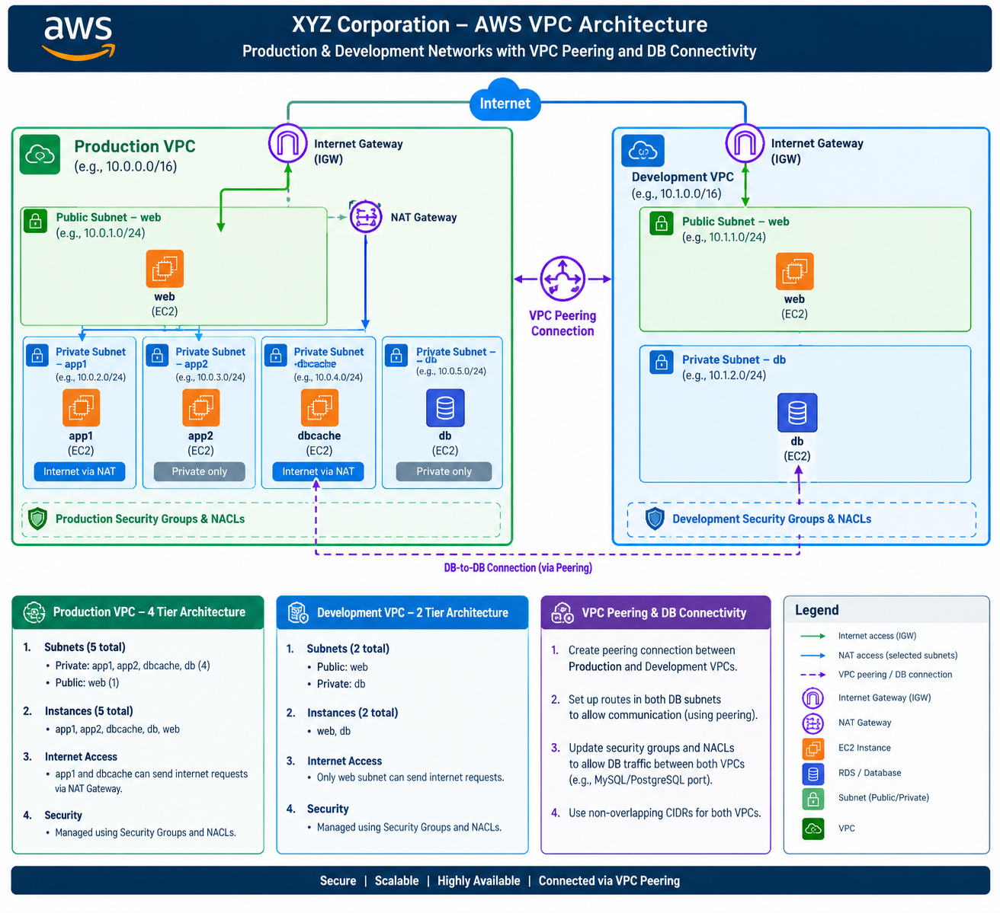
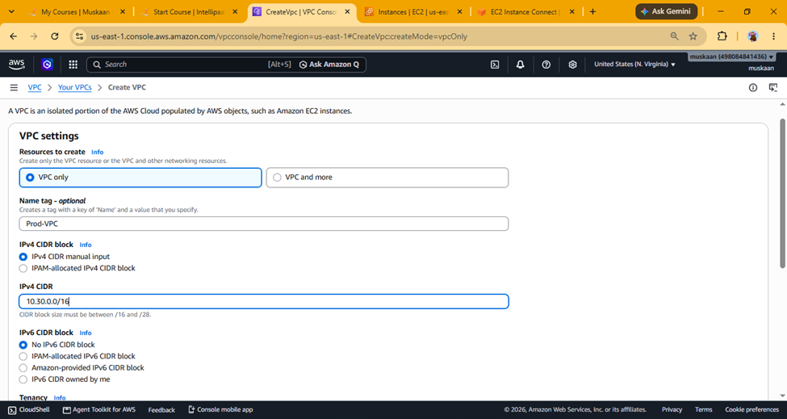
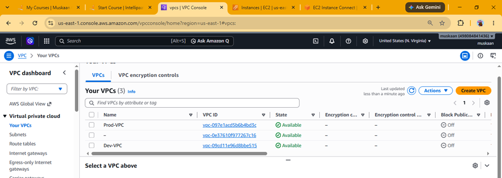
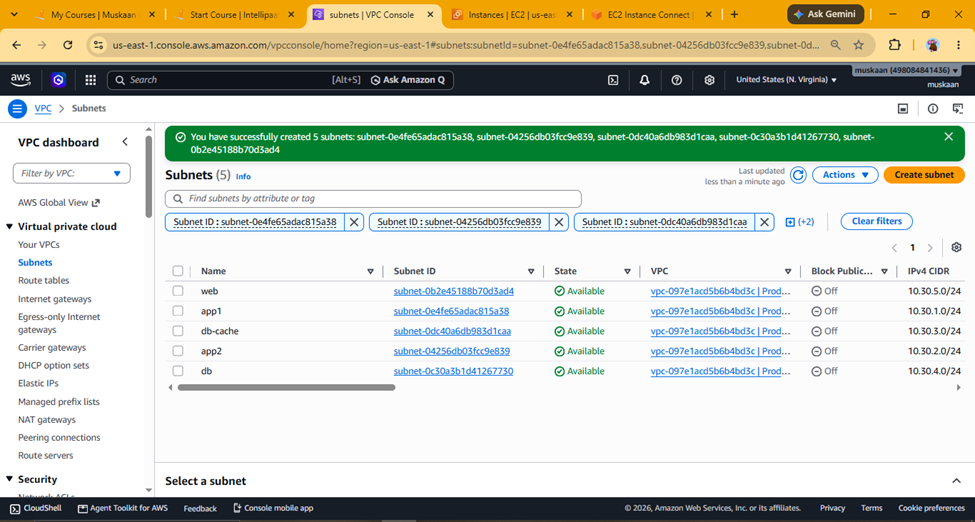
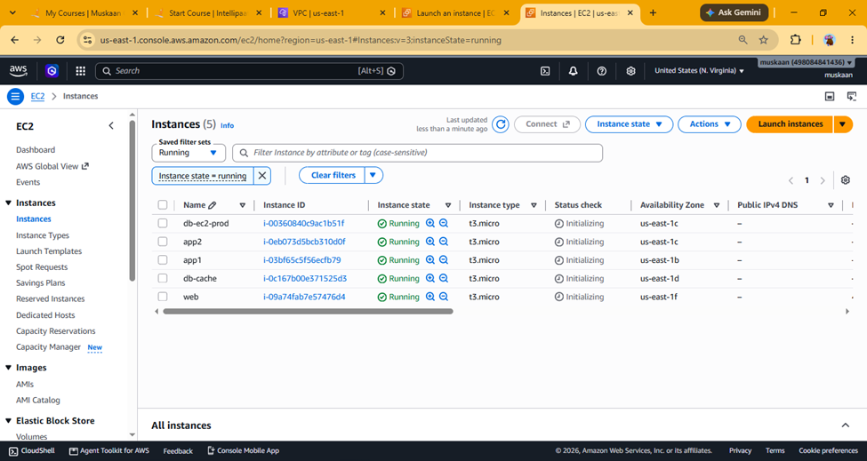

# Module 5: VPC Case Study – 1

## Problem Statement: You work for XYZ Corporation and based on the expansion requirements of your corporation you have been asked to create and set up a distinct Amazon VPC for the production and development team. You are expected to perform the following tasks for the respective VPCs. 
> Production Network:
1.	Design and build a 4-tier architecture.

 
 2. Create 5 subnets out of which 4 should be private named app1, app2, dbcache and db and one should be public, named web.

 
 3.	Launch instances in all subnets and name them as per the subnet that they have been launched in.

 
 5.	Allow dbcache instance and app1 subnet to send internet requests. 

 
 

 
 
 

 
 
 
 
 
 
6. Manage security groups and NACLs.

> Development Network:
1.	Design and build 2-tier architecture with two subnets named web and db and launch instances in both subnets and name them as per the subnet names. 
Created VPC named : Dev-VPC

 
Created 2 Subnets with different availability zones
 

 
Launched 2 instances
 

 

2.	Make sure only the web subnet can send internet requests. 
For this we need Internet gateway, attached IGW to with Dev-VPC,  route table  :

 

 

 

 

 

 

 
3.	Create peering connection between production network and development network. 

 

 

 
Your VPC peering connection (pcx-003e901c0fdbbc69d | Prod-to-Dev-peering) has been established.
To send and receive traffic across this VPC peering connection, you must add a route to the peered VPC in one or more of your VPC route tables.

 
 
 
 
4.	Setup connection between db subnets of both production network and development network respectively.
 
 
 
 
 
